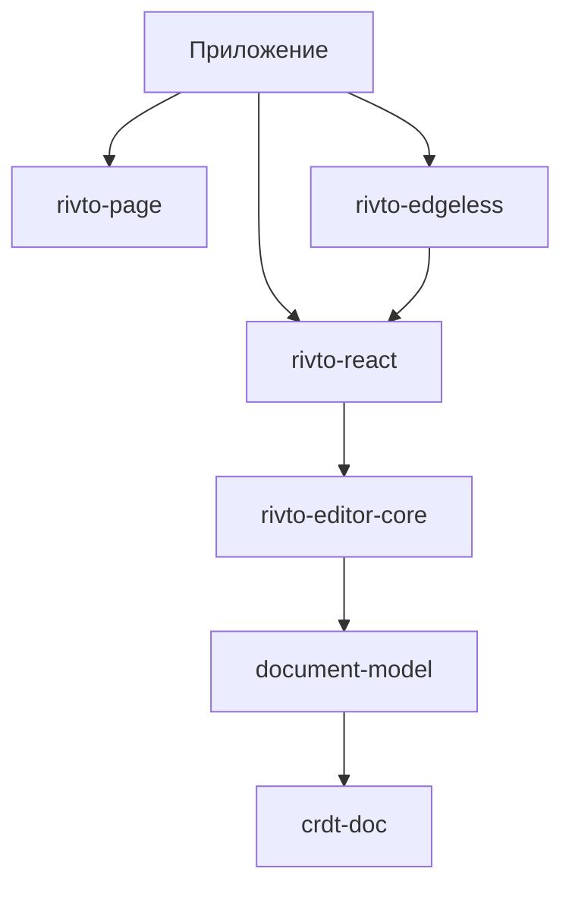

# Разделение Page и Edgeless на расширяемые пакеты

Дата: 2026-10-19. Статус: дизайн и план по текущему checkout; автономный rendering slice
BlockEditor реализован, целевые интеграции и перенос взаимодействий ещё не выполнены.
Уточнённые контракты следующего этапа описаны в
[отдельном документе о BlockEditor](./block-editor-contracts-ru.md); он уточняет ранние
эскизы интерфейсов ниже, без добавления TypeScript API.

Основной результат этой работы — проверенный по исходникам план. В конце предусмотрен первый
небольшой перенос существующего контракта, а не декларация завершения всего разделения.

## 1. Решение и границы

Создать два пакета:

- `packages/rivto-page`, имя `@chulane/rivto-page`: блочный редактор, его контроллер,
  структурные компоненты, layout, slots, общие текстовые взаимодействия, структурный DnD
  и PageSurface. Конкретные блоки и их текстовый UI остаются в react-rivto-editor.
- `packages/rivto-edgeless`, имя `@chulane/rivto-edgeless`: canvas, его контроллер,
  viewport, элементы, инструменты, трансформации, element slots и EdgelessSurface.

`@chulane/rivto-react` остаётся host: React lifetime, EditorPanel, связь с документом,
регистрация расширений, маршрутизация событий между occurrences, общий протокол surface.
Здесь остаются Markdown и остальные конкретные блоки, их schemas/definitions, renderers,
type-specific behaviors и CSS, а также живой реестр динамической регистрации блоков.
Host не импортирует реализации Page/Edgeless, их структурный CSS, DnD, Moveable или
virtualizer. CSS конкретных блоков продолжает принадлежать host.
Приложение явно собирает host и необходимые поверхности. В host нет default surface,
импорта объединённого surface preset и обратного реэкспорта обоих пакетов.

Единственная зависимость BlockEditor и его controller — `BlockEditorAdapter`. Он объединяет
ограниченные blocks/selection/transactions/events/clipboard, живой доступ к renderers и
behaviors, block contributions и окружение области. В нём нет editor/panel/document или
обратных ссылок на них через события. Конкретный controller остаётся внутри Page-пакета;
отдельных `renderers`, `panel` и `registrations` props нет.

Блочный редактор используется дважды: как страница и как содержимое карточки canvas.
Edgeless не импортирует PageSurface, page CSS или внутренние классы блочного DOM.
Приложение подключает компонент и стратегию блочного содержимого через контракт host.
Так можно использовать только page, только canvas с фигурами или оба пакета с карточками.
Третий пакет общего UI сейчас не нужен: общие контракты и действительно общий chrome
остаются в React host. Если host сам не использует примитив, он переезжает к потребителю.

Структурный Page-пакет независим от host, core/model и CRDT, включая type-only imports.
Он определяет собственный минимальный adapter contract; приложение/host integration
адаптирует конкретное хранилище с сохранением cached snapshot identity. Запрещены обратные
импорты host → page/edgeless, page ↔ edgeless и импорты чужого `src/`. Границы конкретной
edgeless integration проверяются отдельно; canonical model остаётся на стороне host/core.
Связь canvas с block content выражается передачей компонента/стратегии из приложения,
а не `import('@chulane/rivto-page')` внутри canvas.

## 2. Что обнаружено в текущем коде

Пути ниже относительно `packages/react-rivto-editor/src/`, если не указано иначе.

| Текущий узел                                      | Наблюдение                                                                 | Следствие для переноса                                                  |
| ------------------------------------------------- | -------------------------------------------------------------------------- | ----------------------------------------------------------------------- |
| `surfaces/surface.tsx`                            | `SurfaceBoundary` даёт контекст, wrappers, before/afterSurface UI          | Это часть host, не одна из реализаций                                   |
| `managers/surfaces/*`                             | Один менеджер совмещает root registry, block/element slots и wrappers      | Разделить конкретные slots и общий surface lifetime                     |
| `surfaces/page/page-surface.tsx`                  | Переменная высота, window virtualizer, pinned roots, scroll anchoring      | Нельзя заменить блоки одинаковыми фиксированными прямоугольниками       |
| `surfaces/page/page-virtualization-controller.ts` | Контракт и WeakMap читаются общими DOM helpers и selection                 | Инвертировать зависимость: протокол принадлежит host                    |
| `surfaces/edgeless/edgeless-surface.tsx`          | Pan/zoom, wheel, spotlight, создание карточек и controls внутри компонента | Перенести состояние и жесты в controller; React оставляет DOM и effects |
| `surfaces/edgeless/edgeless-block.tsx`            | Импорт BlockTree, auto-height через ResizeObserver, обновления без history | Ввести компонент содержимого, сохранить контракт измерений              |
| `surfaces/edgeless/edgeless-tools-context.tsx`    | Один EdgelessToolContext и creation defaults на представление              | Сохранить surface-local ownership; не дублировать через каждый hook     |
| `editor/react-editor.ts`                          | Создаёт edgelessToolbar и общий blockElements projection                   | Host пока знает canvas даже без EdgelessSurface                         |
| `extensions/built-ins/built-ins.ts`               | Standard preset и slash duplicate смешивают block и canvas операции        | Разделить сборку и стратегию duplicate, сохранить transaction           |
| `extensions/block-drag/controller.ts`             | Уже есть PageDragController, используется для обоих режимов                | Переиспользовать, а не писать второй DnD                                |
| `managers/events/panel-dom.ts`                    | PanelDOM ограничивает поиск occurrence, но знает `.page-block-row`         | Общая маршрутизация остаётся; форма block DOM принадлежит page          |
| `managers/clipboard/clipboard-manager.ts`         | Есть ветвление по фактическому surface type                                | Делегировать presentation policy, оставить форматы/валидацию общими     |
| `styles/index.css`                                | В одном entry CSS всех поверхностей, контейнеров и расширений              | Раздельные CSS entry и проверка независимой сборки                      |
| `components/editor-panel/types.ts`                | EditorPanelProps содержит page virtualization options                      | Перенести настройки на PageSurface                                      |

Не следует считать все файлы с `page` page-only: caret navigation, merge, indent,
collapse, list behavior и DnD работают также внутри canvas-карточек. Не следует считать
все операции над elements canvas-only: canonical hierarchy и persistence остаются в model/core.
В текущем core имя режима страницы — `block`, хотя компонент называется PageSurface.
В этом проекте не совмещаем перенос с переименованием persisted режима или схемы.

## 3. Владельцы состояния

| Срок жизни                 | Владелец                            | Что хранит                                                                       |
| -------------------------- | ----------------------------------- | -------------------------------------------------------------------------------- |
| Документ                   | model/core                          | Blocks, elements, hierarchy, plugin data, snapshots, transactions, history       |
| React runtime документа    | host                                | Registrations, format converters, panel registry, document acquisition           |
| Panel occurrence           | host ReactPanel                     | Ограниченные rootBlockId/rootElementId, selection, события, фокус, активность    |
| Смонтированная поверхность | PageController / EdgelessController | DOM binding, viewport, измерения, инструменты, previews, локальные contributions |
| Блочное содержимое         | BlockEditorController в page        | Outline navigation, text DOM, block slots, DnD в заданных пределах               |
| Жест                       | Соответствующий controller/strategy | Захваченные ID, pointer, preview, cancellation и окончательный commit            |

Один editor может обслуживать несколько panels. Несколько canvas не делят pan/zoom,
активный инструмент, preview и текущую сессию defaults. Регистрации типов и toolbar
могут быть общими для runtime; активный tool и его экземпляр принадлежат surface.
Проекция canonical block ranges может кешироваться на документ, но не переносить туда
состояние canvas. Если несколько canvas используют её, edgeless владеет acquire/release
счётчиком, а host не создаёт её без потребителя.

Один panel — одна корневая surface. Вложенный embed другого документа создаёт свой panel.
Карточка того же canvas — ограниченная block editing region того же panel, а не новый
независимый документ/history. Именно region ограничивает merge, caret и структурный drop.

## 4. Протокол React host

Расширить существующий surface механизм, не создавать параллельный plugin framework.
`SurfaceBoundary` и менеджер регистрации остаются точкой подключения. `EditorPanel`
по-прежнему принимает явные children. Контроллер получает host через эту границу.

Уточнённый block контракт описан в [BlockEditor contracts](./block-editor-contracts-ru.md):
компонент принимает один `adapter`, а controller создаётся внутри Page. Самостоятельный
общий базовый SurfaceController пока не вводим; сначала проверяем реальный block lifecycle.

| Раздел единого адаптера                       | Назначение                                                                |
| --------------------------------------------- | ------------------------------------------------------------------------- |
| blocks / region                               | Ограниченные операции и живые границы конкретной страницы или карточки    |
| selection / transactions / events / clipboard | Возможности host без доступа к самому editor/panel/document               |
| renderers / behaviors                         | Живое чтение реестров конкретных блоков, lookup, revision и subscriptions |
| slots / wrappers                              | Block contributions Page с устойчивой registration identity               |
| viewport / navigation                         | Актуальная геометрия и доступность DOM, включая виртуальные корни         |

Отрисовка — `<BlockEditor adapter={adapter} />`. Дополнительные `className` и callback
измерения высоты относятся к presentation, не открывают второй путь к editor.

Координаты `{ x, y }` используют существующий совместимый геометрический тип. Client
points — browser client CSS px, local points — CSS px до canvas transform. Width/height
задаёт окружение через CSS layout: отдельных availableWidth/scale/frame props, дублирующих
реальные размеры, нет. Callback сообщает intrinsic высоту в local CSS px; сам не пишет
в document. Edgeless решает min-height, округление, сравнение с frame и запись без history.
Rotation требует полного обратного преобразования, делить координаты только на zoom
недостаточно. Изменение callback не пересоздаёт adapter/controller.

Не передавать через адаптер `Moveable`, dnd-kit events, virtualizer instance, canvas tool
или конкретный CSS selector. Их реализации остаются в соответствующем пакете.
BlockEditorViewport нужен реальному потребителю DnD/overlay, а не для будущих layout.

`attach` подключает DOM ресурсы после commit React, возвращает идемпотентное отключение
конкретного подключения. Конструкторы только сохраняют зависимости/создают локальные stores.
React StrictMode допускает attach → detach → attach того же экземпляра. `destroy`
окончателен, повторный destroy безопасен; после него attach отвергается. Смена root
отключает старый root до подключения нового. Скрытие panel отменяет незавершённый жест,
приостанавливает input/observers, но сохраняет viewport/defaults при сохранённом mount.
Реализация должна согласовать это с существующим ReactPanel lifecycle, а не вызывать
окончательный destroy из каждого повторяемого StrictMode effect cleanup.

Host владеет identity panel, focus routing, активностью и registration ownership.
Controller получает только BlockEditorAdapter, включая на первом переносе. Прямого
ReactPanelApi и скрытого доступа к editor через context не требуется. Существующие
managers используются реализацией адаптера, но публичный контракт и callback payloads
не должны возвращать их широкие owner/editor/document ссылки. Не копировать весь
ReactPanel API в новый фасад. Разные карточки получают разные bounded adapters,
используя общие document transactions и живые host registries.

### 4.1 DOM selection и виртуализация

Контракт, который общая DOM-selection вызывает у страницы, должен принадлежать host.
Сохранить существующие операции `mountBlocks`, `mountAdjacentBlocks`,
`mountFirstOrLastBlock`, `getSelectionBlocks`, `suspendScrollAdjustments` и их семантику.
На этапе 1 сначала переместить существующий bridge без поведения. Затем заменить
поиск через `.page-surface` на panel/region registration и назвать контракт по фактической
роли block DOM navigation. Не экспортировать старый временный PageVirtualization API.

Итоговый host хранит регистрацию через существующий panel/surface manager, не глобальный
singleton с CSS-поиском. Ближайшая вложенная panel является жёсткой границей даже без
зарегистрированного navigation provider: нельзя заимствовать родительскую виртуализацию.
Невиртуализированный BlockEditor тоже предоставляет navigation provider с теми же
семантическими операциями; его реализация не обязана использовать virtualizer.

DOM range conversion и browser selection остаются общими только настолько, насколько
они работают с переданными endpoints. Поиск строк, children, collapsed outline и
контейнеров переносится в page `BlockDOM`/navigation strategy. `PanelDOM` в host
не должен разбирать структуру чужой block row. Сначала перенести вызывающие пути,
после этого удалить CSS-знание, не вводить одновременно две несовпадающие DOM модели.

### 4.2 Clipboard, selection и команды

Общие serialization, converters, validation, source-document lookup и ограничения
panel остаются в host/core. Представление целевого selection и размещение вставки
определяет стратегия текущей surface/region. Для page это text/outline insertion,
для canvas — element placement, для редактируемой карточки — её block region.

Использовать существующие clipboard strategies и transfer код как основу. Стратегия
выбирается один раз по активной region, не по глобальному mode документа. Вставка
не должна попадать на canvas, когда caret стоит в embedded page того же editor.

Slash duplicate делегирует размещение стратегии: page создаёт соседний subtree;
canvas duplicate карточки сохраняет offset/frame/z-index и корректный диапазон блоков.
Все подготовленные document изменения выполняются в существующей batch transaction.
Cross-document transfer сохраняет текущие правила IDs/collisions и error handling;
не обещать атомарный rollback между двумя независимыми документами.

Selection arbitration: сначала native control/редактируемый текст активной region,
затем block interaction, затем canvas background. Существующие priority/preventDefault
правила остаются основой. Element selection и block selection не получают два обработчика
Delete на один жест. Escape отменяет preview до изменения selection. History — один
документный владелец; поверхности восстанавливают свой DOM caret после undo.

## 5. Page API и ООП-композиция

Экспорты основного entry: `PageSurface`, `BlockEditor`, `PageController`,
`BlockEditorController`, типы props/options, hook доступа к текущему controller,
`PageThemeProvider`, `pageClasses`. Presets/extensions — отдельный `/extensions` entry.
Не экспортировать все private helper-файлы barrel-ом.

`BlockEditor` — полноценное редактирование ограниченного упорядоченного набора блоков:
generic children layout, межблочные текстовые взаимодействия, selection, keyboard, slots
и optional DnD. Content renderers, type-specific layout и текстовый UI поставляет host
через adapter; Markdown и другие конкретные реализации в Page не переносятся.
`PageSurface` добавляет page root, scroll/virtualization, trailing area. Canvas
передаёт BlockEditor через публичный компонент интеграции. BlockEditor не рендерит
второй PageSurface, не создаёт второй undo manager и не запускает window virtualizer.

`BlockEditorController` композиционно использует существующий PageDragController,
block behaviors, DOM navigation и slot registry. `PageController` добавляет layout и
virtualization к BlockEditorController; наследование здесь не нужно. Перенос не должен
превратить controller в новый ReactEditor со всеми managers.

Настройки:

- PageSurface: текущие virtualization threshold/overscan, root layout и тема.
- BlockEditor: один BlockEditorAdapter; region, viewport/navigation, операции и живые
  registries доступны через него. Размеры задаются окружающим CSS layout, высота
  сообщается callback без записи frame внутри блока.
- Renderers и type-specific block behaviors регистрируются в host один раз для runtime,
  используются в обеих презентациях. Page имеет доступ к чтению и subscriptions, а
  register/delete остаются у владельца. Добавление/удаление renderer обновляет content
  без пересоздания адаптера/controller; при отсутствии renderer используется fallback.
- Полная динамическая регистрация типа сохраняет definition/schema, renderer, behaviors
  и slash actions существующего BlockTypeManager; один renderer не заменяет её.

Фиксированная ширина означает доступную ширину layout, а не фиксированную высоту строк.
Fixed height означает ограниченный viewport со скроллом; content height означает
естественный рост. Слоты учитываются в box model согласно anchor: start/end в потоке,
perimeter вне content, body между строкой и children. Рамка карточки задаётся edgeless.

### 5.1 Стратегии вместо набора свободных helpers

- Существующий PageDragController сохраняет capture/update/commit/cancel и cleanup.
- Drop resolver оформляется стратегией только там, где реально различается outline,
  row/column container placement. Metadata контейнеров остаётся входом стратегии.
- Block navigation strategy знает ограниченный outline, collapsed nodes и mounts.
- Геометрия, используемая несколькими взаимодействиями, может стать `BlockGeometry`
  с документированными системами координат; одноразовый helper — private метод владельца.
- React hooks и функциональные компоненты остаются функциями: классы не заменяют hooks.
- Не делать static utility class для каждого однострочного преобразования. Объединять
  helpers по одной ответственности, переносить текущие пояснения и тесты вместе с ними.

### 5.2 Slots

Block slot registry и его типы принадлежат page; element slots — edgeless. Host оставляет
только общую композицию surface before/after/wrappers, если она нужна самому host.
Сохранить все 12 perimeter anchors, start/end/body для блоков, priority descending,
mode filters и predicates на переходе. Сохранить stable registration ID: добавление
соседнего slot не remount-ит существующий. Cleanup удаляет конкретную регистрацию,
даже если тот же компонент зарегистрирован дважды.

Target API разделяет region kind от mode: BlockEditor внутри canvas — block region,
но старый mode filter `edgeless` при миграции не теряется. Перевод фильтров отдельным
шагом с тестами; не заменить все фильтры на `page` механически.

## 6. Edgeless API и ООП-композиция

Экспорты основного entry: `EdgelessSurface`, `EdgelessController`,
`useEdgelessController`, типы options/props, существующие публичные tool/element
контракты, `EdgelessThemeProvider`, `edgelessClasses`. `/extensions` содержит
selection, transform, movement, deletion, visuals, toolbar и complete preset.

Controller композиционно владеет viewport state, существующими tool context,
creation defaults, snapping, transient property/transform previews и gesture lifetime.
Не создавать новую копию EdgelessOperations: перенести её и свести владение в одном
controller. UI использует один существующий экземпляр через context.

Viewport strategy переводит client/world/local coordinates, отвечает за pan/zoom,
zoom around cursor, wheel routing и отмену pan при blur. Transform strategy сохраняет
Moveable, snapping и group transforms. Element definitions/creation preparation остаются
расширяемыми через текущий registry. Controller вызывает их, не содержит switch всех типов.

Компонент принимает optional `blockContent` интеграцию. Приложение передаёт реализацию
из page: React component плюс стратегию block operations в пределах карточки. Отсутствие
интеграции не должно молча скрывать persisted block cards: показывается unavailable
renderer с понятной причиной; команды создания таких карточек недоступны. Canvas с
одними visual elements работает без установки page.

Карточка владеет world frame, rotation, z-index, selection border и element slots.
Block content владеет outline, text, block slots, внутренним scroll и drag. Измерение
intrinsic height отправляет callback; canvas сохраняет нынешнее отсутствие лишнего undo
для auto-height. Во время resize preview чтение размеров не должно коммитить промежуточный
frame в документ. Preview завершается одной user transaction, Escape не создаёт undo.

Block range projection (`startBlockId`/`endBlockId`, separators, reconciliation) остаётся
одной реализацией, переносится вместе с потребителями. Canonical invariants model не
переписываются. Конкретная projection integration живёт в edgeless и поставляется
приложением при включении block cards. Нельзя заставлять pure page создавать canvas cards.

## 7. Полная матрица переноса поведения

Это обязательный checklist: перенос файла без сохранения поведения не закрывает строку.
Все директории расширений включены; custom приложения и demo проверяются отдельно.

| Возможности / текущий источник                                           | Владелец после переноса                                                              | Обязательная проверка                                                      |
| ------------------------------------------------------------------------ | ------------------------------------------------------------------------------------ | -------------------------------------------------------------------------- |
| BlockTree/View/Wrapper, generic slots и layout                           | page                                                                                 | Recursive children, renderer overrides, selection anchors                  |
| Markdown, unknown/error и другие конкретные renderers, их CSS            | react-rivto-editor                                                                   | Recursive children, renderer overrides, selection anchors                  |
| `block-behaviors`, block metadata, list props                            | Page — общий механизм; host — type-specific behaviors; model/core — persisted schema | Composition order, container boundaries, parent outline                    |
| Built-ins page: creation, merge forward/backward, outdent, reset, indent | page BlockEditor                                                                     | Enter/Backspace/Delete/Tab, selection/caret, undo в page и card            |
| Caret/block navigation, keyboard move                                    | page                                                                                 | Collapsed outline, card boundaries, virtual gaps                           |
| List shortcuts, checkbox, numbering, collapse                            | page                                                                                 | Persisted properties, hidden descendants, number continuation              |
| Trailing block, default writing factory                                  | Page — trailing area; host — writing factory и конкретный тип через adapter          | Empty document, custom writing type, семантическая пустота                 |
| Block handle, context menu, drag metadata                                | page                                                                                 | Все actions, modifiers, focus, nested menu, touch/keyboard                 |
| `extensions/block-drag/**`                                               | page                                                                                 | Pointer/keyboard, preview, auto-scroll, root/gap/child/container placement |
| Cross-document DnD/clipboard transfer                                    | host transport + page placement strategy                                             | Copy/move, source failure, collisions, bounded roots                       |
| `bullet-threading`                                                       | page optional extension                                                              | Collapse, nested rows, hover/selection, theme                              |
| Containers bento/columns/table/kanban                                    | react-rivto-editor: конкретные блоки, renderers, behaviors и CSS                     | Resize/reorder, nested layout, empty destinations, undo                    |
| `todo-item` / todo storage                                               | react-rivto-editor: конкретные блоки и их UI                                         | Properties, status order, storage menu, nested content                     |
| `embedding`, BlockModal, EditorEmbed                                     | host acquisition + injected page presentation                                        | Missing/loading/error, replicas, nested roots, scroll/focus                |
| Text selection and native browser offsets                                | host conversion + page DOM strategy                                                  | Cross-block UTF-16, IME, selection restoration                             |
| History                                                                  | core + host binding                                                                  | Один history owner, undo/redo across both surfaces                         |
| Clipboard formats/converters                                             | host + presentation strategies                                                       | Copy/cut/paste page↔card↔canvas, external plain text                       |
| Slash menu/action registration                                           | host command registry; page popup/actions, canvas placement                          | Duplicate card vs block, contextual availability                           |
| `elements/block-element-projection*` и reconciliation                    | edgeless integration                                                                 | Canonical ranges, deletion/merge/separators, shared projections            |
| Canvas viewport/grid/controls                                            | edgeless                                                                             | Wheel pan, Ctrl/Meta zoom, space pan, native control scroll                |
| Edgeless selection/deletion/movement                                     | edgeless                                                                             | Marquee, toggle, groups, keyboard steps, read scopes                       |
| Moveable/transform/snapping                                              | edgeless                                                                             | Move/resize/rotate, groups, connectors, one undo per gesture               |
| Visual element definitions/renderers/geometry                            | edgeless                                                                             | Rectangle, text and current registered types, frame/style                  |
| Tools: creation/drawing/eraser/connector/presets                         | edgeless                                                                             | Preview, commit/cancel, endpoints and hit testing                          |
| Property editors, toolbar/groups/defaults                                | edgeless                                                                             | Live inherited defaults, explicit values, invalidated previews             |
| Block/element slots и wrappers                                           | page / edgeless / host respectively                                                  | Stable identity, priority, cleanup, all anchors                            |
| Custom demo elements/tools (включая mindmap), renderers                  | host application integrations                                                        | Public API only, no internal imports                                       |
| Selection/control markers, UI scope, portals                             | host semantic markers + package DOM owners                                           | Native controls, nested panels, theme in portals                           |
| Debug UI / block labels в demo                                           | приложение через публичные API                                                       | Выключены/включены, не ломают performance                                  |

Для завершения этапа 0 получить машинный список imports/exports каждого source файла и
сопоставить его этой таблице. Это выявит неучтённые вспомогательные файлы, CSS и tests.
Не считать таблицу автоматическим доказательством отсутствия потерянных функций.

## 8. CSS и тема

Public class objects небольшие и статические. Предлагаемый минимум:

- `pageClasses`: root, block, row, content, children, slot, dragPreview, dropIndicator.
- `edgelessClasses`: root, viewport, plane, element, card, overlay, toolbar, slot.

Остальные классы private; не экспортировать каждую кнопку и служебную CSS переменную.
CSS class — styling hook, а не поведенческая identity. DOM delegation использует
семантические attributes/registration и DOM adapter, не className, которую меняет тема.
Public classes остаются на DOM; пользователь добавляет свои, а не подменяет служебные.

Theme providers каждого пакета наследуют общие editor tokens и накладывают свои typed
CSS custom properties. Theme не меняет document props. Nested provider переопределяет
только переданные значения. Размеры, влияющие на hit testing, измеряются из реального DOM,
а не дублируются числовыми константами в controller и CSS. У темы нет произвольного
"behavior configuration" и доступа к mutable controller.

Portal требует явного themed portal container в пределах текущей occurrence либо
переноса resolved CSS variables на portal root; один React context не переносит CSS
inheritance через portal в body. Overlay координаты согласуются с выбранным контейнером.
Проверить clipping модальных окон и overflow; не лечить его глобальными viewport-wide
pseudo-elements на каждом block.

CSS entries: host `styles.css` — tokens/shared chrome и стили конкретных блоков
(Markdown, containers, todo и остальных); page `styles.css` — block shell/layout, slots,
DnD и page features; edgeless `styles.css` — canvas. Общие layers объявлены одинаково,
импорт обоих CSS в любом порядке не меняет геометрию. Moveable CSS scoped canvas root,
block styling scoped BlockEditor root. Canvas не содержит селекторов `.page-block-*`.
Tailwind source scanning каждого published package включает только его исходники;
проверить сборку из `dist`, чтобы workspace aliases не скрыли недостающий CSS.

## 9. Последовательность этапов

Каждый этап — самостоятельный reviewable diff с обновлением этой заметки. Сначала
сохраняем поведение и ownership, затем чистим имена и CSS. Не совмещать механический
перенос, переписывание геометрии и изменение публичной семантики в одной стадии.

### Ближайший этап — автономный каркас BlockEditor без интеграции

По уточнению пользователя сначала разрабатываем высокоуровневый каркас в `rivto-page`.
Подключение к текущему editor, PageSurface, canvas и demo пока отложено. Описанные далее
этапы инверсии и переноса сохраняются как последующая работа; прежняя рекомендация начать
с действующего пути рендеринга через host на этом ближайшем этапе не применяется.

1. Оформить минимальные контракты единого BlockEditorAdapter, controller и компонента.
   Сохранить возможность будущего подключения bounded blocks, selection, transactions,
   events/clipboard и живых registries через один объект, без editor/panel/document.
2. Внутри Page реализовать только необходимые для автономного каркаса обязанности
   controller и компонента: lifetime, чтение корней/отдельных блоков, точечные подписки
   и поиск content renderer. Остальные согласованные возможности пока остаются планом;
   не добавлять фиктивные методы, пустые managers или публичные заглушки.
3. Проверять каркас небольшим тестовым adapter и локальными test renderers. Не создавать
   production adapter react-rivto-editor и не переносить Markdown/конкретные блоки.
4. Предусмотреть структурную цепочку BlockEditor → shell → renderer с ограниченным
   block context. Физический перенос существующих BlockTree/View, CSS и взаимодействий
   выполнить позже вместе с проверкой интеграции, не переключая текущий runtime сейчас.
5. Проверить package build/typecheck/lint и автономные behavioral/cost assertions.
   Вызовы существующего редактора, новые demo routes и реальный host wiring не входят
   в этот этап. Baseline production demo фиксируется перед последующим вмешательством
   в действующий путь, а не выдаётся за измерение ещё не подключённого каркаса.

Требования к производительности с первого шага:

- Стабильные controller/adapter и snapshots до соответствующего изменения; повторное
  чтение неизменившихся данных не создаёт новый снимок или копию дерева документа.
- Изменение content одного блока не будит подписчиков незатронутых блоков и всего дерева.
- Изменение selection обновляет presentation только блоков с изменившимся selected state.
- Изменение root order, content и registry имеют отдельные наблюдаемые зависимости.
- Динамическая регистрация renderer не пересоздаёт controller и не remount-ит content
  неизменившихся типов; удаление использует fallback без переписывания document data.
- Подписки/DOM ресурсы устанавливаются по lifecycle и освобождаются без накопления;
  конструкторы не выполняют внешнюю регистрацию. Pointer/geometry paths остаются
  обязанностями последующих шагов, без преждевременного глобального store.

Выход: автономный высокоуровневый каркас пакета и проверяемая граница adapter, рассчитанная
на эффективное подключение страницы/карточки. Это не завершённый перенос и не доказательство
производительности реального editor. Следующий этап — production adapter и постепенное
подключение к существующему rendering path с baseline и проверками обеих поверхностей.

### Этап 0 — инвентаризация и baseline

1. Зафиксировать clean/dirty status и исходный commit, source/export/import карту.
2. Сопоставить все extensions, CSS entries, test fixtures, demo/docs/app consumers.
3. Прогнать выбранные lifecycle/page/canvas/DnD проверки и baseline performance на
   production demo с default settings и `?repeat=200`.
4. Сохранить команды, результаты, browser/build context, median/range в разделе выполнения.

Выход: feature matrix без невладельческих строк, измеренный baseline перед runtime edits.
На этой стадии документ можно ревизовать без изменения runtime.

### Этап 1 — инверсия конкретных зависимостей host

1. Перенести существующий virtualization bridge из `surfaces/page` в host managers.
   Первый пробный перенос сохраняет код и имена; это ещё не финальная абстракция.
2. На существующих callers определить block navigation protocol и registration на region.
   Убрать CSS `.page-surface` lookup с сохранением изоляции nested panels.
3. Разделить DOM endpoint conversion и конкретную BlockDOM структуру.
4. Вынести clipboard/duplicate placement в существующие стратегии.
5. Подготовить передачу block content в canvas вместо прямого BlockTree import.

Выход: host navigation/selection не импортирует `surfaces/page`; host не угадывает
layout по CSS. Тесты на virtual gaps, embedded panel, root replacement и cleanup проходят.
Первый пункт может быть отдельным механическим коммитом до изменения runtime.

### Этап 2 — BlockEditor controller и region

1. Оформить единый BlockEditorAdapter без editor/panel/document и широких callback
   payloads. Собрать BlockEditor из BlockTree/View, generic slots/behaviors и bindings;
   definitions, Markdown и прочие конкретные renderers/behaviors оставить в host.
2. PageDragController получает viewport/region adapter; убрать чтение edgeless dataset
   из page logic, сохранить pointer и keyboard paths и внешние drop targets.
3. PageSurface и EdgelessBlockElement используют один BlockEditor implementation.
4. PageController владеет virtualizer adapter и page-only scroll/trailing behavior.
5. Перенести virtualization props с EditorPanel на PageSurface и обновить всех callers.
6. Подключить живой read-only renderer registry через adapter на основе RenderersApi:
   проверить регистрацию/удаление типа и fallback без пересоздания controller.

Выход: одинаковое поведение внутри страницы/карточки, region не выходит за boundaries,
размеры согласованы, нет второй модели/history. Проверить обычные и вложенные контейнеры.

### Этап 3 — физический page package

1. Создать package manifest, public entries, tsconfig, build и CSS; workspace peer React.
2. Перенести page-owned структурный список из матрицы вместе с tests, styles и JSDoc.
   Markdown и другие конкретные блоки, их CSS, definitions и type-specific behaviors
   остаются в host и подключаются через adapter. Markdown-зависимости, добавленные при
   scaffolding Page, удалить через CLI, если у структурного пакета не останется потребителя.
3. Разделить mixed built-ins/preset; host history и converters не регистрируются дважды.
4. Обновить demo, docs, app imports, Jest mappings, TS paths и Vite aliases.
5. Проверить standalone consumer против собранного package, без source aliases.

Выход: page-only consumer не импортирует Moveable, canvas renderer/toolbar/tools/styles.
Edgeless временно внутри старого пакета получает block integration из приложения,
а не создаёт обратную зависимость host → page.

### Этап 4 — EdgelessController и scoped extensions

1. Перенести viewport/gesture state из компонента, переиспользовать tool context/operations.
2. Перенести edgeless toolbar, creation defaults, element registration и projection ownership
   из общего ReactEditor в edgeless installation/controller с явным lifecycle.
3. Canvas extension UI подключается только к нужному controller, не ко всем surfaces
   через shared afterSurface без проверки владельца.
4. Сохранить previews/validation/transactions, cleanup и multi-canvas isolation.

Выход: pure host/page runtime не создаёт canvas managers; StrictMode не дублирует
listeners/tools. Один canvas gesture → один commit; отменённый gesture → ноль mutations.

### Этап 5 — физический edgeless package

1. Перенести edgeless-owned список, Moveable dependency, styles и tests.
2. Обновить custom tools/elements и приложения на публичные entry points.
3. Собрать visual-only consumer без page и combined consumer с blockContent integration.
4. Удалить legacy реэкспорты и оставшиеся canvas-specific поля host API.

Выход: ациклический dependency graph, отдельная публикация, отсутствие скрытых deep imports.
Breaking imports разрешены, migration aliases не нужны. Persisted data shape не меняется.

### Этап 6 — CSS контракт и theme providers

1. Зафиксировать минимальные public classes и typed tokens по реальным компонентам.
2. Удалить cross-surface selectors после переноса DOM behavior на adapters.
3. Реализовать providers, nested theme и portal propagation.
4. Проверить стандартную тему, одну альтернативную, оба порядка CSS imports,
   fixed/auto-height cards, модальные окна и host page с собственным CSS.

Выход: theme не ломает hit testing; компоненты не зависят от private class соседнего пакета.
Скриншоты и реальные mouse/keyboard проверки обязательны для CSS/layout изменений.

### Этап 7 — окончательная проверка и документация

1. Закрыть все строки feature matrix тестом/проверкой и указать известные gaps.
2. Повторить baseline scenarios на production build под теми же настройками.
3. Проверить build/typecheck/lint, docs и standalone dist consumers.
4. Написать API usage для page-only, visual-only и combined редактора, custom block,
   custom tool, slots/theme и embedded document.
5. Удалить временные bridge exports/legacy selectors и пустые фасады.

Выход: host использует surfaces через протокол; оба пакета расширяются независимо,
поведение сохранено, все измеримые регрессии разобраны. Не завершать стадию по числу
перемещённых файлов или успешному одному TypeScript check.

## 10. Проверки и критерии приёмки

Unit/type tests: SurfaceManager registration identity, owner cleanup, panel lifecycle,
root scopes, shared tool session, virtual navigation, selection boundaries, clipboard
placement, duplicate semantics, projection ranges, slot ordering, strategy failures.
Дополнительно: adapter не раскрывает whole editor через поля или callback payloads;
динамическое добавление/удаление renderer и behavior обновляет существующий BlockEditor
без пересоздания controller; definition/slash lifecycle сохраняется; fallback не меняет
persisted block type и content.
Импортные ограничения проверять на resolved dependencies, включая dynamic imports,
barrels и CSS imports, а не только по отсутствию строк `page-` в одном файле.

Фокус E2E из существующего набора:

- `panels`, `editor-lifecycle`, `embeddings`, `embedding-loading`, `cross-document-editors`;
- `selection`, `structured-selection`, `keymap`, `lists`, `collapse`, `history-delete`;
- `page-drag-*`, `clipboard-drag`, `clipboard-converters`, `nested-containers`;
- `bento`, `columns`, `table` проверяется по фактически имеющимся тестам и container suite,
  `kanban`, `todo-item`, `todo-storage`, `block-modal-overflow`;
- `edgeless`, `edgeless-wheel`, `edgeless-state-lifecycle`, `moveable*`;
- `edgeless-creation-preview`, `edgeless-property-preview`, `edgeless-custom-tool`,
  `edgeless-toolbar-groups`, `element-registration`, connector и mindmap сценарии.

Behavior: Chromium и Firefox, `--workers=12`; каждый failed test повторить отдельно
с `--workers=1` перед классификацией, результаты не смешивать. Performance: свежий
`pnpm demo:build`, отдельный preview URL, `--workers=1`, normal и `?repeat=200`, default
virtualization. Использовать `performance.spec.ts`, `block-number-performance.spec.ts`,
`block-handle-performance.spec.ts` по затронутым путям.

Измерять synchronous operation и время до DOM/selection отдельно; real pointer/keyboard,
прогрев и несколько эквивалентных samples, median/range. Проверять результат операции,
не только скорость. Следить за subscriptions, forest reads, mounted nodes, layout reads.
Новый controller не должен добавлять rerender всех rows на pointermove/pan/selection.

Отдельно требуются: два canvas одного документа; две page replicas; page внутри canvas
через embed; canvas без block integration; source deletion во время drag/preview;
unmount/switch/disable во время жеста; React StrictMode; keyboard-only DnD; portals/theme;
CSS с host reset; package dist consumer. Отсутствующие сценарии добавить на затрагивающем этапе.

## 11. Повторные проверки дизайна и внесённые уточнения

### Проход 1: зависимости и сохранение функциональности

Исходная идея «перенести page и edgeless directories» отвергнута после проверки
built-ins, block-drag и EdgelessBlockElement. Добавлен переиспользуемый BlockEditor,
отдельные region boundaries и полная матрица расширений. Fixed width отделена от
variable content height и fixed-height viewport.

### Проход 2: утечки и lifetime

Проверка ReactEditor, clipboard, panel DOM и tool provider выявила reverse dependency
на page virtualization и canvas-specific managers в host. Добавлены этап инверсии,
placement strategies, explicit blockContent, shared projection ownership и правила
StrictMode. Controller не создаётся независимо каждым hook; тема учитывает portals.

### Проход 3: проверка целевой сборки и условий удаления legacy

Проверка CSS entry, package manifest и demo aliases показала, что успешный dev demo
не доказывает независимость пакетов. Добавлены page-only/visual-only/dist consumers,
CSS import order, перенос peer/dependencies и запрет host реэкспортировать реализации.
Разделены промежуточный механический bridge move и окончательный протокол: перенос
WeakMap сам по себе ещё не устраняет CSS-зависимость и свободные функции.

Сценарии мысленной проверки: page-only без canvas dependencies; visual-only без page;
canvas card с text selection и DnD; nested source panel другого документа; два canvas
с общей моделью; замена surface в ходе preview. Для каждого указан владелец состояния,
путь команды и cleanup. Это анализ дизайна, не результат выполненных browser tests.

## 12. Первая реализация и журнал проверки

Исходно после сохранения и трёх проходов дизайна предполагалось выполнить этап 1.1: механически
перенести текущий `page-virtualization-controller.ts` в `managers/surfaces/`, поменять
все импорты. Сохранить существующий контракт, алгоритм, CSS lookup и документацию.
Так общие DOM managers перестают импортировать реализацию из `surfaces/page`.
Новый публичный API не вводится до реализации region registration и проверки потребителей.

Это частичный этап 1, не готовые два пакета. CSS-зависимость и функции bridge остаются
явным долгом этапа 1.2; будущий controller/registry заменяет их после behavioral tests.

Проверки этого переноса: сравнение содержимого перемещённого файла с baseline,
отсутствие старых import paths, React typecheck, lint изменённых файлов, существующие
selection/panel DOM/surface-manager tests. Runtime алгоритмы не меняются, поэтому
новый performance baseline и browser timing для этого механического шага не требуются;
до этапа 1.2 применяется полный workflow выше.

Результаты выполнения будут дописаны после проверок. Остальные этапы остаются планом.
Этот перенос не является ближайшей задачей: по последнему уточнению сначала создаётся
автономный каркас BlockEditor без production-интеграции, как указано в разделе 9.

### Выполнение: создание пакета блоков

По уточнению пользователя начинаем с создания пакета, до переноса runtime. Создан
`packages/rivto-page` (`@chulane/rivto-page@0.1.0`) через `pnpm init`, manifest настроен
через `npm pkg set`, TypeScript config инициализирован через `tsc --init` и сокращён до
наследования workspace config. Зависимости добавлены через `pnpm add`:

- Workspace: React host, editor core, document model.
- Блочное взаимодействие: текущие четыре пакета dnd-kit и TanStack React Virtual.
- Отображение: react-markdown, remark-gfm, rehype-highlight.
- Сборка и типы: tsup, TypeScript, React typings; React/ReactDOM — peer dependencies
  `>=18 <20` и development dependencies для локальной сборки.

Пакет подключён к корневым `build`, `clean`, `check-types`. `packages/*` уже включён в
workspace, поэтому менять workspace glob не потребовалось. Основной entry пока пустой:
компоненты, контроллеры и CSS будут перенесены отдельным этапом; обратного реэкспорта из
host нет. На момент начала этого этапа bridge виртуализации остаётся по старому пути
в `surfaces/page`; описанный выше пробный перенос не входит в текущий diff.

Пройдены build (ESM и declarations), package typecheck и lint. `pnpm install
--frozen-lockfile` подтверждает согласованность workspace manifest/lockfile.
Browser/performance проверки не применимы: этот этап добавляет конфигурацию и пустой
entry, существующий editor runtime не изменён.

### Уточнение после обсуждения: один adapter и конкретные блоки в host

Согласовано: BlockEditorController остаётся в Page; компонент и controller получают
один BlockEditorAdapter. Весь editor/panel/document не передаётся явно или через скрытый
context. В adapter объединены ограниченные операции, живые registries и окружение region.
Markdown и все остальные конкретные block implementations остаются в react-rivto-editor.
Renderers передаются как наблюдаемый registry, а не статический список: host регистрирует
типы динамически, Page читает и подписывается, не пересоздавая controller.

Это уточнение ownership, API, матрицы и стадий переноса. Выполненный ранее CLI scaffolding
сохранён как факт, runtime/manifest в этой документационной правке не изменяются.

### Выполнение: автономный каркас BlockEditor

Ближайший автономный этап выполнен в границах чтения/отображения: единый adapter с region,
blocks, selection и живым renderer lookup, локальный controller с DOM lifetime, компонент,
адресные hooks и memoized block forest. Текущие host, PageSurface, canvas и demo не изменены.
Concrete blocks и их стили остаются в react-rivto-editor; input, DnD, slots, collapse и
другие следующие части не заменены пустыми реализациями.

Подробности публичного среза, ограничения SSR/первого render, cleanup и проверки указаны
в [разделе выполнения BlockEditor contracts](./block-editor-contracts-ru.md#13-выполнено-автономный-rendering-slice).
Пройдены 10 tests, build/typecheck/lint, форматирование и frozen-lockfile install. Cost
checks на 5/2000 roots подтверждают адресное обновление без чтения корней и соседних nodes.
Latency действующего editor и browser input намеренно не измерялись до его подключения.
Unused scaffold dependencies удалены через CLI; взаимодействия подключат свои библиотеки
на соответствующих стадиях. Это завершение автономного среза, не всего переноса пакетов.

### Уточнение: adapter не импортирует canonical model

Из автономного Page удалена зависимость от document-model, включая BlockNode type import.
Первоначальный собственный структурный node описывал только id/type/childIds; после
OOP-шага он называется BlockEditorNodeSnapshot, см. уточнение ниже. Renderer владеет content
и другими специфичными данными, host адаптирует canonical snapshots без обязательного
копирования. Общие structural hooks, shell и controller не знают schemas/pluginData.
Manifest и lockfile обновлены через CLI; старый model symlink удалён перед проверкой
самостоятельной сборки. Задача конвертации .cjs отменена пользователем, эти файлы сохранены.

### Выполнение: кешируемые OOP-узлы без второго хранилища

В автономном Page добавлен BlockEditorNode с live getters, getSnapshot/subscribe и
командами checked/collapsed/color. BlockEditorController переиспользует один узел
на ID в своём кеше, а useBlockNode возвращает этот объект, подписывая React на отдельный
immutable BlockEditorNodeSnapshot. Изменения делегируются ограниченному
adapter.blocks.updateBlockNode; validation, область доступа, transactions и undo остаются
обязанностью host. Полный editor/panel/document в API не появляется.

Объекты сохраняются при изменениях и delete/restore, после destroy инвалидируются;
посещённые IDs удерживаются до конца жизни контроллера. DOM controls, numbered list,
production adapter и подключение поверхностей этим шагом не реализуются.
Поведение, границы кеша, проверки и отдельный Node microbenchmark описаны в
[разделе 16 контрактов](./block-editor-contracts-ru.md#16-выполнено-стабильный-blockeditornode-и-команды-через-host).
Результаты синтетических чтений не заменяют будущие browser measurements интеграции.

### Уточнение: listType вместо отдельного numbered-флага

Анализ существующей list extension показал пять режимов и раздельные пути отображения
(CSS counters + virtual window seed) и сериализации (проекция номеров по siblings).
В автономный node API добавлены собственный BlockListType, listType getter/snapshot field
и setListType с null для снятия режима. Renderer type, checked и другие поля независимы;
составные conversion/Enter-команды остаются следующим шагом вместе с behaviors.
Порядковый номер не хранится в узле, соседние snapshots при смене режима не переписываются.

Подробный разбор текущих путей и границ адаптации — в
[разделе 17 контрактов](./block-editor-contracts-ru.md#17-выполнено-тип-списка-в-контракте-узла).
Прошли 24 tests, package typecheck/lint/build; на 5/2000 nodes команда не читает соседей
или roots. Production wiring и browser numbering этим шагом не переносились.

### Выполнение: package-local demo без production integration

Добавлен `packages/rivto-page/demo`: один in-memory adapter, textarea renderer, controls
текущих node fields, live renderer registration, selection, reorder и mount/unmount.
Запуск: `pnpm --filter @chulane/rivto-page demo`, localhost:5184; большой fixture доступен
через `?repeat=200`. Vite добавлен через CLI как devDependency, production dependencies
пакета и существующий demo не менялись.

Прошли 24 Jest tests, typechecks, lint и builds; browser behavior — четыре проверки
Chromium/Firefox с workers=12, performance — четыре проверки с workers=1. На 5+1 и
1000+200 nodes клавиатурная смена list type сохраняет objects, не читает roots и вызывает
17 node reads/два уведомления. Тайминги и ограничения интерпретации сохранены в
[разделе 18 контрактов](./block-editor-contracts-ru.md#18-выполнено-автономное-browser-demo-внутри-пакета).
Это проверка автономного контракта в браузерах, без завершённого переноса list UI,
production blocks, clipboard, selection/navigation и undo.

### Уточнение: color — фон блока

Исправлена ошибочная трактовка цвета как text formatting: самостоятельный node API
использует color/setColor для фона блока. Production host хранит соответствующий токен
в listProps.backgroundColor; адаптация и удаление override по null остаются на его стороне.
Page shell отражает фон в data-block-background. В demo используются все семь фоновых
токенов оригинала; текст и snapshots соседей при смене фона не изменяются.
Подробности и проверки — в [разделе 19 контрактов](./block-editor-contracts-ru.md#19-исправлено-color-означает-фон-блока).

### Выполнение: BlockView и расширяемые slots

В автономном Page выделен BlockView и реализован BlockSlotRegistry с immutable snapshot,
стабильными entry IDs, priority/when/mode и индивидуальным disposer. Через единый adapter
передаются read-only slots и фактический mode; регистрации принадлежат host/extensions.
Сохранены start/end/body и 12 perimeter anchors. Базовые checkbox/list marker/collapse
подключены в demo через обычные contributions, а не зашиты в concrete renderer.

Структурный stylesheet экспортируется как styles.css; наружу выставлены шесть CSS names
и переменные geometry/theme. Фон оформляет BlockView. Нумерация использует scoped CSS
counters, collapse размонтирует descendants и их подписки без замены кешированных узлов.
Production containers/childrenVisible policy, navigation, virtualization и DnD пока не
переносились. Контракты, границы и проверки — в
[разделе 20](./block-editor-contracts-ru.md#20-выполнено-структурный-blockview-slots-и-базовые-controls).

### Обязательное правило: CSS defaults находятся в пакете

Правило записано в package AGENTS.md. Row padding, root/child gaps, indent, start gutter,
control/marker dimensions, selection и default palette перенесены из demo в stylesheet
Page. Публичный BlockEditorThemeProvider принимает типизированные CSS parameters;
standalone consumer не копирует .demo-* selectors. В demo остались chrome и собственные
примерные forms, а compact mode использует public parameters. Regression отключает
весь demo stylesheet и проверяет geometry/palette; отдельный сценарий меняет параметры
без замены node objects. Подробности — в
[разделе 21](./block-editor-contracts-ru.md#21-правило-пакета-обязательный-css-и-параметры-принадлежат-page).

### Выполнение: Tailwind CSS и shadcn/ui внутри Page

Через CLI установлены Tailwind v4 и shadcn Button/Checkbox/NativeSelect/Textarea/Badge.
Структурные классы используют utilities через @apply, сохраняя шесть public hooks и
публичные geometry/theme parameters. Controls используют shadcn primitives; для
checkbox команды теперь приходят через onCheckedChange, collapse сохраняет text focus.
CSS counters, palette expressions и border shorthand остаются пакетной CSS логикой.

Utilities используют префикс page:, Tailwind variables — --page-*; reset ограничен Page UI
primitives. Глобальный Preflight не подключён. Shadcn colors наследуют Page theme
parameters, и host не обязан копировать отдельную global shadcn theme. Package build
компилирует готовый styles.css через Tailwind CLI, demo использует Vite plugin.
Production ReactEditor/EditorPanel не подключались.

### Host-selected block display list

The current autonomous BlockEditor contract supersedes the earlier region source
proposal: adapter.blocks exposes getBlockIds and subscribeBlockIds together with
addressed node operations. The host may display blocks without a common parent
or owner. There is no BlockEditorRegion, region snapshot, or availability status
in this slice. Node childIds retain their real hierarchy. Stable immutable list
references and list-only subscriptions keep node edits independent of list reads.
See section 27 of block-editor-contracts-ru.md for the implemented boundary.
Future editing permissions must be designed from concrete interactions rather
than inferred from a synthetic display-list owner. Production integration remains
a separate stage.

### Host-owned BlockEditorController

The current autonomous API uses a data-only adapter (blocks and selection) and a
host-owned BlockEditorController with slots, renderers, extensions, and focus event
observers. Hosts provide contributions/callbacks to Page-owned managers and render
<BlockEditor editor={editor}>. Concrete block implementations remain in the host.
View unmount and StrictMode replay detach only; final editor destruction belongs to
the session owner. Synchronous extension setup captures manager resource ownership,
rolls it back on failure, and releases it after custom cleanup on removal.
Section 28 of block-editor-contracts-ru.md describes the implemented lifecycle and
subscription boundaries. Keyboard dispatch and production wiring remain later work.

### Replaceable JSX block layouts

The next autonomous slice replaces a fixed BlockTree interior with Page-owned
BlockNode boundaries and host-owned layouts registered alongside content. Layouts
compose shared primitives in their chosen JSX order; BlockChildren retains recursive
identity/subscription ownership. Kanban/Bento demos validate parent-owned child
placement and controls without CSS structure overrides, DOM lookup, or portals.
Explicit inside/between zones resolve geometry through the topmost hit's registered
ancestors, with real-parent/live-neighbor validation and occurrence-scoped cleanup.
This stage does not install gestures or move commands. See section 29 of
block-editor-contracts-ru.md for the implemented contracts and verification.
